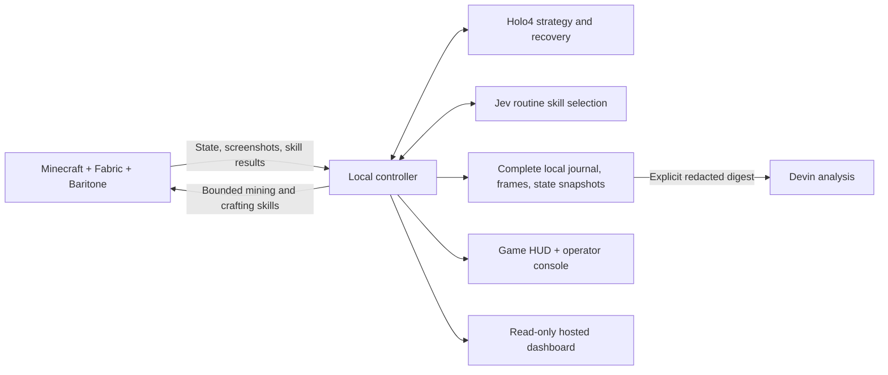

# HoloSpeed

A state-aware Minecraft speedrunning agent with **Holo4 strategy**, **Jev skill
selection**, a custom Fabric bridge, and local navigation, mining, and crafting.
The current target is **Nether entry**, with verified checkpoints for resources,
portal discovery, chest loot, repair, ignition, and dimension transfer. Stone tools
remain an independently verified early-game checkpoint. The agent uses normal
survival interactions and checks progress against game state.

**[Watch the live dashboard](https://holospeed-live-kepard.kepard.chatgpt.site)**
H.264 live video, private operator controls, detailed event logs, input telemetry, model latency,
objectives, and run archives. Its H Company-inspired design uses Cal Sans.
The publisher must remain running alongside Minecraft; stale/offline states are explicit.
See [dashboard setup and source](dashboard/README.md).

Minecraft **Java Edition 1.21.1 + Fabric** is the live target. A separate simulated
mode runs without Minecraft or model APIs. Actual trials have acquired wood, crafted
tools, returned to a placed table, and autonomously reached the Nether from an
empty inventory on the fixed seed; full speedrun completion is not yet implemented. Gladia is deferred.

## Try the console


Install [uv](https://docs.astral.sh/uv/getting-started/installation/) and Python 3.11
or newer. From the repository root:

```sh
uv sync --extra dev
uv run holospeed serve --mode demo
```

Open **http://127.0.0.1:8765** and select **Start run**. The simulated sequence
demonstrates objectives, inputs, latency traces, four milestones, run logging, and
replay. **Pause** and **Resume run** retain the current run; **End run** finalizes
it so the next start creates a new archive entry. There is no automatic start.

The console requires no Node.js build and no API keys in demo mode. Its images,
milestones, and model latencies are clearly labeled as simulation. Use it for
presentation rehearsal and integration checks, not gameplay-performance claims.

## Connect Minecraft

The selected demonstration seed is [`-1950884254474434485`](docs/demo-seed.md),
used in verified Java 1.21.1 set-seed runs. Its nearby ruined portal supports a
short [Nether-entry route](docs/nether-route.md). The executor checks actual loaded
blocks and acquired chest supplies before attempting repair.

Run the controller and Minecraft on the same computer. The bridge binds to
loopback and authenticates with a local token.

1. Install **Java 21**, Minecraft **Java Edition 1.21.1**, and
   [Fabric Loader](https://fabricmc.net/use/installer/) **0.16.14 or newer** for
   that Minecraft version. Select the intended launcher instance and its actual
   game directory; custom launcher instances may not use the default `.minecraft`.
2. Copy `.env.example` to `.env` in this repository. Set `HCOMPANY_API_KEY` and,
   to enable Jev, `JEV_API_KEY`. The defaults are `holo4-35b-a3b` with reasoning
   effort `none`, `jev-1.14.0`, and a 30-second model request timeout.
   `GAMEPLAY_MODE=state` and `RUN_GOAL=nether` are the live defaults. Set
   `RUN_GOAL=early_game` to stop at stone tools. Holo4 chooses objectives at phase
   boundaries using structured state and screenshots. Jev selects routine skills;
   local prerequisites and inventory checks govern execution. Model planning is
   bounded to eight seconds with a logged deterministic fallback. Keep provider
   credentials in the controller environment, not the mod configuration.
3. Generate matching controller/mod credentials from the repository root:

   ```sh
   uv run holospeed init-bridge --minecraft-dir "/path/to/your/game-directory"
   ```

   Replace the path with the selected instance directory, not its `mods` folder.
   This writes a token to `.env` and `<game-directory>/config/holospeed.json`.
   If changing `HOLOSPEED_PORT`, set it in `.env` before running this command so
   both endpoints use the same port.
4. Build the client mod:

   ```sh
   cd fabric-mod
   ./gradlew build
   ```

   On Windows, use `gradlew.bat build`. Copy
   `fabric-mod/build/libs/holospeed-0.1.0.jar` into the instance's `mods` folder
   together with [Fabric API](https://modrinth.com/mod/fabric-api) for **1.21.1**
   (the build uses `0.116.5+1.21.1`). Do not install the `-sources.jar`.
5. Install the pinned [Baritone](https://github.com/cabaletta/baritone) **1.11.3**
   Fabric API distribution into the same profile (required for mining/navigation):

   ```sh
   python scripts/install-baritone.py --minecraft-dir "/path/to/your/game-directory"
   ```

   The installer verifies the official artifact's SHA-256 and writes source/license
   attribution beside it. Baritone remains an unmodified, replaceable LGPL dependency.
6. Return to the repository root and start the controller:

   ```sh
   uv run holospeed serve --mode live
   ```

7. Restart Minecraft with that Fabric profile, enter a survival world, and wait
   for the bridge to connect. Keep Minecraft focused and press **F9** to start
   or resume a run. Actions are rejected when the world is unavailable, the game
   is paused, or the window is unfocused.

The mod draws a compact HUD with objectives, strategy, inputs, decision latency,
elapsed time, and milestones. Screenshots are captured before this HUD is drawn,
so the agent sees vanilla game UI rather than its own presentation.

**F8** immediately stops inputs and latches the bridge off. **F9** rearms it and
requests start/resume from the controller with a fresh observation. Both keys work
in inventory screens. See the [mod guide](fabric-mod/README.md) and
[demo checklist](docs/demo-checklist.md). Disconnects, expired actions, focus loss,
and world changes also release held controls.

The bridge exposes player/inventory state, screens, crosshair, nearby loaded blocks,
collision geometry, and entities through a bounded 5 Hz cache. Baritone executes
navigation and mining; native recipe and inventory interactions craft tools and
place/open a carried table. Local tick loops continue without model round trips.
Skills have inventory targets, tick/wall deadlines, and cancellation guards.

## Logs, replay, and comparison

Each run is preserved locally under `runs/<run-id>/`:

```text
summary.json     mode, status, elapsed time, configuration, metrics, milestones
events.jsonl     ordered observations, model payloads, decisions, inputs, ACKs, errors
frames/          captured PNG/JPEG observations with hashes in the event journal
states/          complete structured snapshots, compressed JSON with journal hashes
```

The default `runs/` directory and `.env` files are Git-ignored. Logs retain model
requests and responses, including their image payloads, with credential redaction.
Frame files are retained separately for replay. There is no automatic retention
policy, so plan disk space and keep the entire run directory when archiving a demo.
Legacy visual-mode recovery notes also persist in `runs/memory.jsonl` for later context.
The hosted dashboard receives sanitized, size-bounded archives; local run directories
remain the complete record, including screenshots and every polled state snapshot.

Open **Run archive**, select two saved runs, and choose **Compare runs** for a
side-by-side view of duration, completed actions, observations, errors, recoveries,
token usage, and the four milestone splits. DEMO/LIVE labels remain visible;
missing values are shown as not recorded. Select a run to inspect its evidence.
Replay supports scrubbing and 1×, 2×, and 4× playback.
**Download events** exports the full JSONL journal; screenshot files remain in
the run directory. The comparison uses saved summaries; the journals provide
the detailed evidence behind those figures.

For local journal analysis without API calls:

```sh
uv run holospeed report "runs/<run-id>"
uv run holospeed compare "runs/<first-id>" "runs/<second-id>"
```

Reports reconcile control acknowledgments and model usage, summarize latency,
and preserve the distinction between recorded execution and claimed progress.

Replay reconstructs recorded observations and actions. It does not replay inputs
into Minecraft or reproduce the world deterministically. The timer measures
elapsed session wall time, including pauses, rather than official speedrun
in-game time. State-aware milestones require actual inventory or table evidence and are labeled
`game_state`. Historical visual-mode milestones remain model claims; simulated
records are labeled separately.

## Ask Devin to investigate a run

The [live integration investigation](docs/devin-investigation.md) includes actual
Devin findings and explicitly unvalidated test proposals. See the [Devin guide](docs/devin.md)
for current-fix context and the bounded, redacted workflow.


Analysis is separate from gameplay and never starts automatically. First prepare
the bounded, redacted digest without calling Devin:

```sh
uv run holospeed analyze "runs/<run-id>"
```

To submit it, set `DEVIN_API_KEY` and `DEVIN_ORG_ID` in `.env`, then run:

```sh
uv run holospeed analyze "runs/<run-id>" --submit
```

`--submit` creates a Devin v3 session with a **2-ACU cap** and can incur API usage.
The request asks for failure causes, focused tests, and proposed fixes against
`Kepard/42hackathon`, branch `feat/holospeed-agent`; it does not authorize merges,
deployments, pushes, or pull requests. Only selected diagnostic fields are sent:
no screenshot attachments, local files, raw model bodies, or provider credentials.
Devin memory is disabled for the session. Uncommitted local changes are not
available to Devin through GitHub.

```sh
uv run holospeed devin-identity
uv run holospeed devin-session "<session-id>"
```

The first command reads account information to help locate the organization ID;
the second reads a submitted session's status and structured findings. An
ambiguous submission timeout is not retried automatically, because the session
may already have been created. Inspect Devin session history before retrying.

## How it fits together



The prerequisite planner credits existing tools and consumed ingredients, choosing
only currently eligible skills. Holo4 selects among those candidates at the first
objective, milestone changes, and recovery points. Jev handles routine selections.
Models choose candidate IDs; they cannot change counts or inject arbitrary controls.
Fresh state revalidates each selection before execution, and inventory postconditions
verify completion afterward. Failed routes are excluded for unchanged inventory;
three consecutive skill failures stop the run.

`MAX_ACTIONS=300` counts completed skills and `MAX_RUN_SECONDS=1800` bounds elapsed
run time by default. Each mining skill has its own limit and stuck detection;
crafting waits for inventory synchronization. F8, focus loss, world changes,
disconnects, and deadlines cancel local execution.

`GAMEPLAY_MODE=visual` preserves the earlier screenshot/control experiment,
including fresh Jev validation, eight consecutive vetoes, and bounded camera recovery.
Its latency and progress limitations motivated the current architecture. Historical
[gameplay findings](docs/gameplay-findings.md) and [Jev evaluation](docs/jev-evaluation.md)
remain available. See [architecture](docs/architecture.md), [providers](docs/providers.md),
[research and attribution](docs/state-aware-research.md), and [protocol](docs/protocol.md).

## Development and current limits

See the [verification report](docs/verification.md) for actual live-run evidence,
test results, and the distinction between control integration and wood/tool success.

```sh
uv run pytest
uv run ruff check controller
```

Run `./gradlew build` in `fabric-mod` for Java compilation and action validation
tests. Python tests exercise provider contracts with mock transports, redaction,
replay journals, pause/timeout/disconnect behavior, and the complete simulated
demo. They do not establish performance in an actual Minecraft world.

The ruined-portal route currently targets the declared fixed seed and requires
actual chest supplies; random-seed portal construction, combat, stronghold routing,
and full speedrun completion remain future work. Structured
state is bounded to loaded nearby terrain; it is not an omniscient world map.
Automated tests verify orchestration and inventory accounting; only recorded real
Minecraft trials establish gameplay success. See the [demo checklist](docs/demo-checklist.md).
