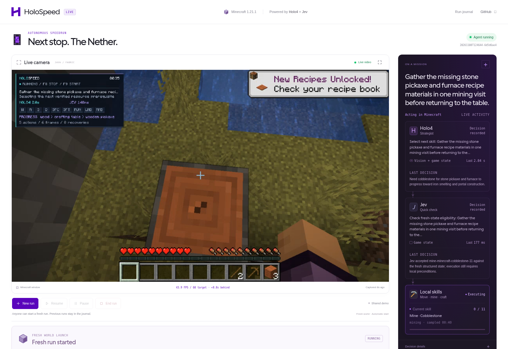
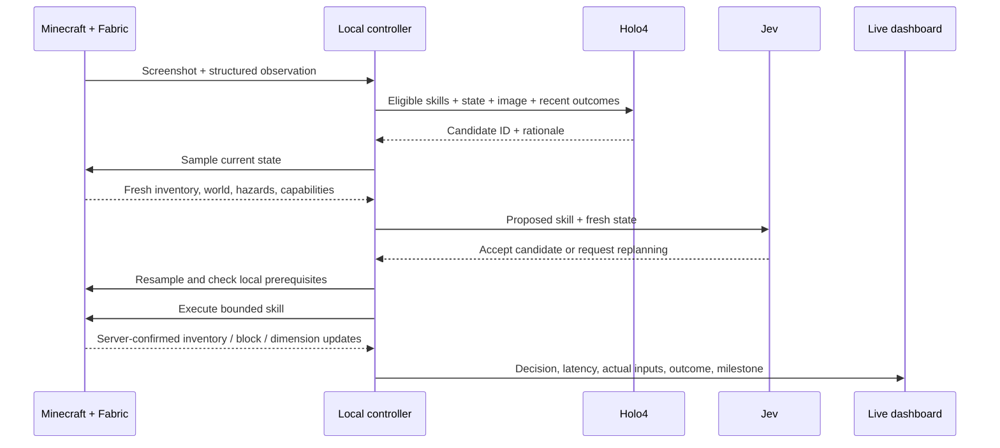
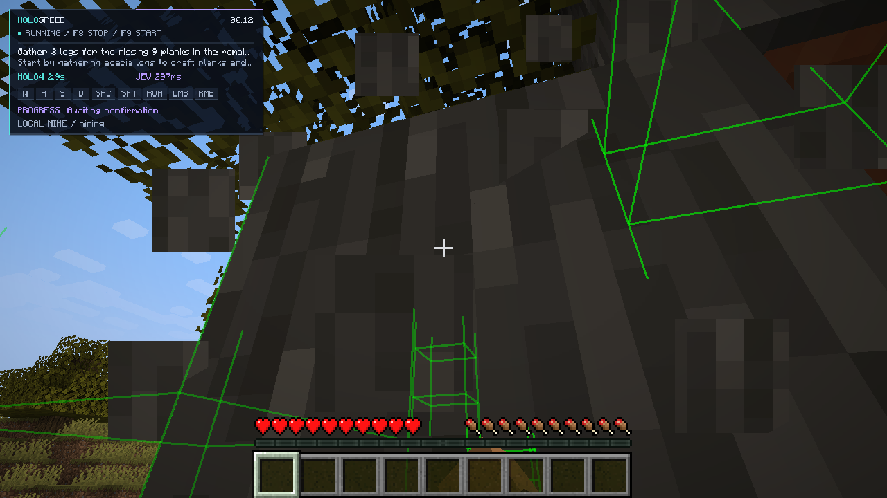
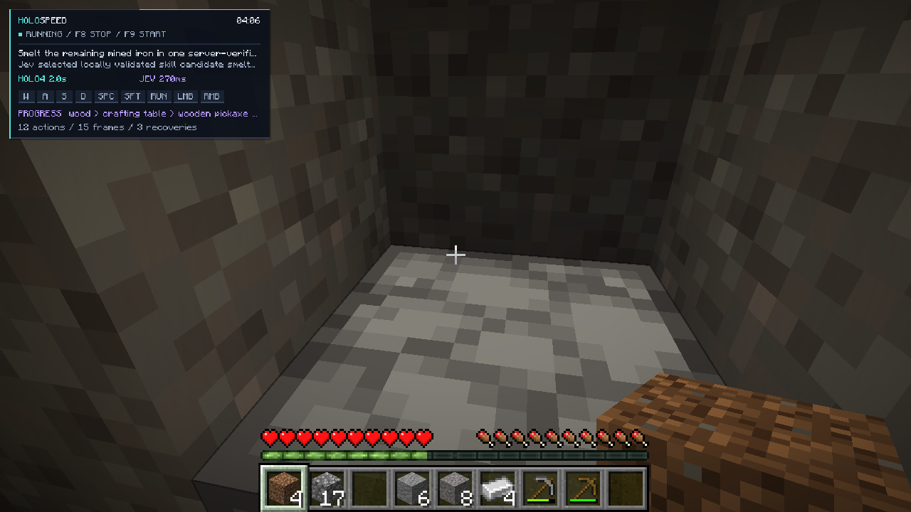
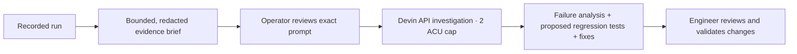

# HoloSpeed

**Holo4 plans. Jev checks. Minecraft moves.**

HoloSpeed is an autonomous Minecraft agent built around H Company’s **Holo4** and
TypeSafe AI’s **Jev**. It combines visual reasoning, fresh game-state validation,
and local execution to turn model decisions into precise gameplay. The current
mission is **empty inventory → tools → smelted iron → bucket-cast portal → Nether**.

**[Watch the live dashboard](https://holospeed-live-kepard.kepard.chatgpt.site)** ·
[Jury description](docs/jury-description.md) · [Setup](docs/setup.md)

[](https://holospeed-live-kepard.kepard.chatgpt.site/)

*The live dashboard: Minecraft gameplay alongside Holo4’s strategy, Jev’s fresh-state
checks, measured model latency, and local skill execution.*

## How Holo4 and Jev drive the run

| Component | Input | Responsibility |
| --- | --- | --- |
| **Holo4 · `holo4-35b-a3b`** | Minecraft screenshot, summarized game state, eligible skills, recent outcomes, operator guidance | Choose the next progression objective, resource, or recovery approach at phase boundaries. |
| **Jev · `jev-1.14.0`** | Newly sampled structured state and bounded skill candidates | Validate Holo4’s proposal against current conditions; select routine skills between strategic calls. |
| **Python controller** | Model selections and fresh client observations | Account for recipe prerequisites, reject stale or invalid choices, dispatch one skill, and verify its outcome. |
| **Fabric mod + Baritone** | Bounded skill request | Execute navigation, aiming, mining, pickup, crafting, smelting, and bucket placement locally. |



Holo4 sees the game before choosing an objective; its screenshot excludes the
presentation HUD. Observations also include inventory, health, nearby loaded
blocks, entities, screen state, and executor capabilities. The model receives a
compact summary; detailed collision geometry stays with the local executor.
Jev checks **start prerequisites** without requiring an action’s future outcome
to exist already. Its explicit `__replan__` response prevents execution.

Model calls happen at skill boundaries, with an eight-second decision budget.
Controls remain released during planning; movement and interaction run locally
between decisions. The controller samples state again after inference, so a
valid-looking answer cannot authorize an obsolete action. Service fallbacks are
explicitly labeled in the journal and mission panel.

### Decision and execution contracts

Models select immutable candidates. The controller owns item counts, target
coordinates, deadlines, and interaction parameters. For example, Holo4’s native
`select_skill` tool returns:

```json
{
  "candidate_id": "craft-minecraft-stone_pickaxe-1",
  "rationale": "Upgrade the pickaxe before mining iron."
}
```

Jev’s `/v1/systemone` choice response selects that same ID or `__replan__`:

```json
{
  "answers": {
    "skill": {
      "type": "choice",
      "choice": "craft-minecraft-stone_pickaxe-1"
    }
  }
}
```

After fresh local validation, the authenticated WebSocket bridge receives:

```json
{
  "type": "skill",
  "id": "craft-stone-pickaxe-request",
  "skill": "craft",
  "item": "minecraft:stone_pickaxe",
  "target_count": 1,
  "max_ticks": 400
}
```

`target_count` is the required total inventory count. An accepted request is
followed by state polling and a verified postcondition. Every request retains its
ID, source observation, provider, measured latency, usage, and result. See the
[provider contracts](docs/providers.md), [state schema](fabric-mod/STATE_PROTOCOL.md),
and [skill protocol](fabric-mod/SKILL_PROTOCOL.md).

## From an empty inventory to the Nether

The Java **1.21.1 / Fabric** route gathers every required material. It uses a
prepared survival world with natural trees, iron, gravel, water, and lava;
the executor verifies loaded terrain around the configured lava landmark.

| Stage | Dashboard checkpoints |
| --- | --- |
| Establish tools | Wood → crafting table → wooden pickaxe → stone pickaxe |
| Produce iron equipment | Furnace → iron mined → iron smelted → bucket → flint and steel |
| Construct and enter | Water collected → lava located → portal built → portal lit → Nether |

Baritone handles navigation, mining, and collection. Vanilla recipe and container
interactions handle crafting and smelting. The casting skill uses a bucket,
water, temporary supports, and ten distinct natural lava sources to create ten
new obsidian frame blocks. Server block updates verify construction and ignition;
a fresh Nether dimension observation completes the goal only with construction
proof from the same recording.

Each skill has cancellation, tick and wall-clock deadlines, and inventory or
world-state postconditions. Failed approaches feed the next planning step.
Pause, F8, disconnect, focus loss, and unexpected world changes release controls;
goal completion also requests singleplayer pause.

## A live demonstration you can supervise

Actual Minecraft gameplay with the in-game HoloSpeed telemetry overlay:

| Autonomous wood gathering | Smelted iron acquired |
| --- | --- |
|  |  |
| Recorded decisions: Holo4 **2.9 s**, Jev **297 ms**. | Four iron ingots in inventory; latest Jev decision **270 ms**. |

The [dashboard](https://holospeed-live-kepard.kepard.chatgpt.site) combines an
H Company-inspired interface, Minecraft inventory and progression visuals, and
[Cal Sans](https://github.com/calcom/sans).

- **Live camera:** Minecraft-window H.264 video, a 60 FPS capture target, and
  measured browser playback FPS. Video runs independently of model inference.
- **ON A MISSION:** actual Holo4 → Jev → local skill activity, each model’s input
  source, latest decision, measured latency, and expandable technical evidence.
- **Run controls:** anyone can choose **New run** without a password. It copies
  the prepared empty-inventory world and reports **Save → Copy → Load → Verify
  → Start**. Gameplay timing begins after loading; previous worlds and recordings
  are preserved. **Pause**, **Resume**, and **End run** require a private operator
  link, as do voice steering and Devin investigations.
- **Run inspector:** health, hunger, inventory, live inputs, fourteen checkpoint
  splits, searchable events, previous runs, and downloadable sanitized journals.

### Gladia: voice in the control loop

With a private operator link, click **Speak** in **Talk to HoloSpeed** beside the
camera to open a Gladia v2 live transcription session. The browser streams
16 kHz mono PCM audio to Gladia and
shows partial captions. Only final utterances enter the authenticated, run-bound
command queue:

| Say | Effect |
| --- | --- |
| “Pause the game.” | Release controls and pause the available singleplayer world. |
| “Gather wood before going further.” | Add objective guidance to the next Holo4/Jev planning step. |
| “Why are you mining iron?” | Ask Holo4 for an answer grounded in the latest recorded state. |

Questions run separately so they cannot delay pause or stop. Typed messages use
the same command path. The API key stays server-side; the browser receives a
session-specific WebSocket URL. [Voice integration](docs/gladia.md).

### Devin: turn a failed run into an engineering task

**Devin engineering** connects recorded behavior to actionable improvements:



The selected run supplies skill outcomes, inventory evidence, and failures.
The brief adds the controller checkout revision at preparation time and notes
that uncommitted changes may differ. The operator reviews the exact prompt and
its digest before creating a session. Submission is idempotent per run and runs
outside gameplay.
Findings and proposed test source appear in the dashboard for review. A
[real investigation](docs/devin-investigation.md) diagnosed a historical
crafting-table return failure and produced two proposed regression-test files;
those proposals were retained for review, not applied automatically.
[Devin workflow](docs/devin.md).

## Complete evidence, reproducible review

Each run keeps the complete local record with credential redaction:

```text
runs/<run-id>/
├── events.jsonl      observations, model payloads, decisions, actions, results
├── frames/           captured gameplay images
├── states/           compressed structured observations
├── summary.json      timing, usage, outcomes, milestone evidence
└── engineering/      reviewed Devin briefs, receipts, findings
```

The public dashboard receives sanitized, bounded copies. Local archives retain
full requests and responses, screenshots, state snapshots, and timing for replay
and comparison. Milestones link to observed evidence; the timer measures session
wall time, including pauses. The displayed timer and recorded result duration
freeze at goal completion, terminal failure, or the run budget. Later diagnostic
events retain their full wall timestamps. Explicit resume includes the paused
interval and starts the timer moving again.

**Current validation:** hosted **New run** has launched a verified fresh world.
An autonomous run completed fourteen skills through gathering, crafting, mining,
smelting four iron ingots, and crafting a bucket and flint and steel. Full portal
construction and Nether entry still await live verification. The present scope
ends at Nether entry.
[Verification](docs/state-aware-verification.md) · [Independent judge](docs/run-judge.md).

[Architecture](docs/architecture.md) · [Live setup](docs/setup.md) ·
[Prepared world](docs/demo-seed.md) · [Dashboard](dashboard/README.md) ·
[Research and attribution](docs/state-aware-research.md)

Baritone **1.11.3** is an unmodified LGPL dependency installed from its official
release. Task decomposition and evidence checks draw on research into AltoClef,
Mineflayer, and Voyager; source links and licensing notes are in the research guide.
