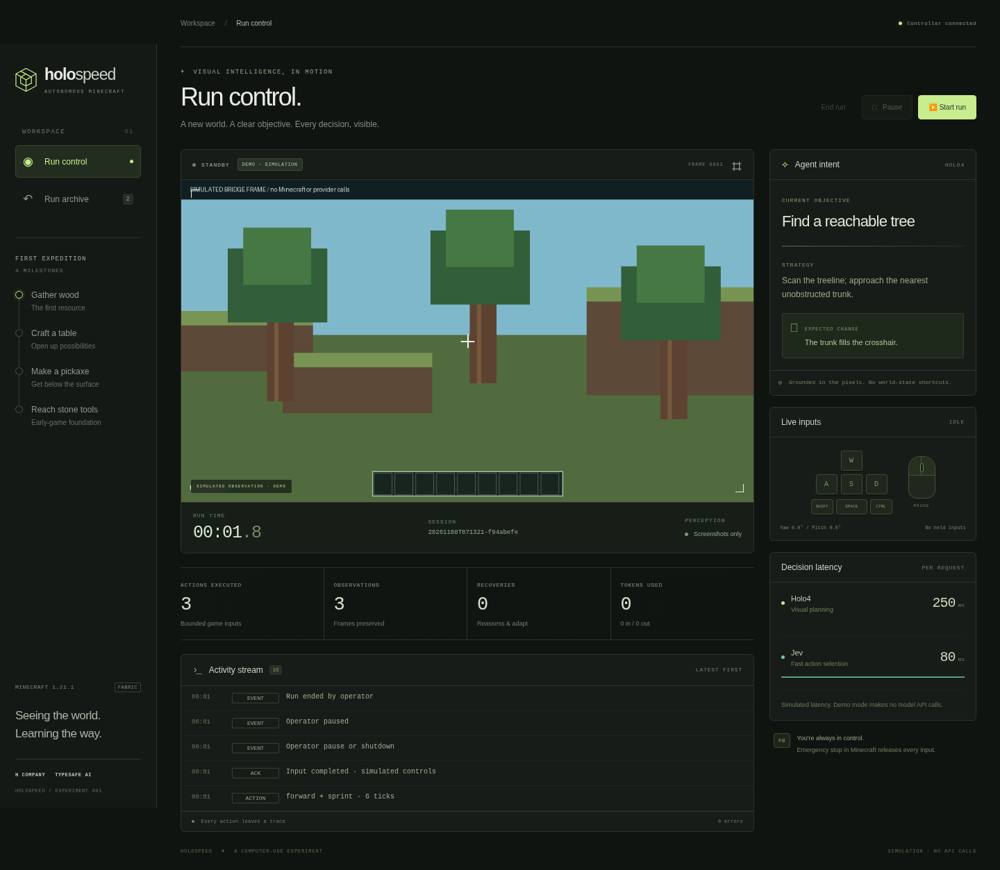
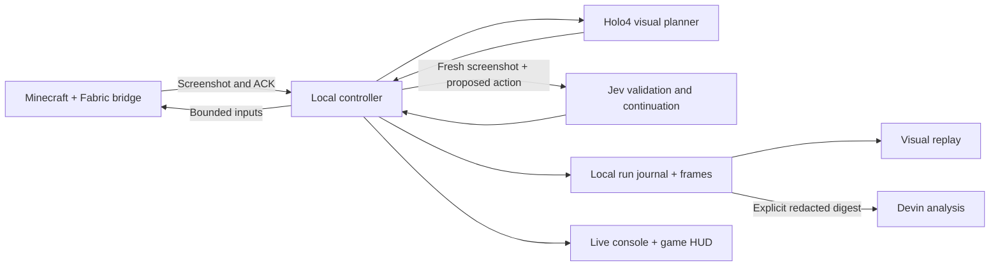

# HoloSpeed

A visual Minecraft agent with Holo4 planning, fresh-frame Jev validation, a
custom Fabric control bridge, and a live spectator console. The first gameplay
target is **wood → crafting table → wooden pickaxe → stone tools**.

This repository includes a runnable **simulated demonstration** and an experimental
live integration for **Minecraft Java Edition 1.21.1**. The simulation uses generated
frames and scripted decisions; it makes no model API calls and does not run Minecraft.
Autonomous early-game success has not yet been validated in a real Minecraft session.
Gladia voice integration is deferred.

## Try the console



Install [uv](https://docs.astral.sh/uv/getting-started/installation/) and Python 3.11
or newer. From the repository root:

```sh
uv sync --extra dev
uv run holospeed serve --mode demo
```

Open **http://127.0.0.1:8765** and select **Start run**. The simulated sequence
demonstrates objectives, inputs, latency traces, four milestones, run logging, and
replay. **Pause** and **Resume run** retain the current run; **End run** finalizes
it so the next start creates a new archive entry. There is no automatic start.

The console requires no Node.js build and no API keys in demo mode. Its images,
milestones, and model latencies are clearly labeled as simulation. Use it for
presentation rehearsal and integration checks, not gameplay-performance claims.

## Connect Minecraft

The selected demonstration seed is [`-1950884254474434485`](docs/demo-seed.md),
used in verified Java 1.21.1 set-seed runs. Start with the wood-and-tools objective.

Run the controller and Minecraft on the same computer. The bridge binds to
loopback and authenticates with a local token.

1. Install **Java 21**, Minecraft **Java Edition 1.21.1**, and
   [Fabric Loader](https://fabricmc.net/use/installer/) **0.16.14 or newer** for
   that Minecraft version. Select the intended launcher instance and its actual
   game directory; custom launcher instances may not use the default `.minecraft`.
2. Copy `.env.example` to `.env` in this repository. Set `HCOMPANY_API_KEY` and,
   to enable Jev, `JEV_API_KEY`. The defaults are `holo4-35b-a3b` with reasoning
   effort `none`, `jev-1.14.0`, and a 30-second model request timeout.
   `HOLO_COMPACT=true` uses concise native control calls to reduce response latency;
   `HOLO_COMPACT=false` retains verbose strategy responses. Optional model intent
   and control descriptions are displayed without inventing achieved outcomes.
   Without a Jev key the controller uses Holo4 for every decision. Keep provider
   credentials in the controller's environment, not the mod configuration.
3. Generate matching controller/mod credentials from the repository root:

   ```sh
   uv run holospeed init-bridge --minecraft-dir "/path/to/your/game-directory"
   ```

   Replace the path with the selected instance directory, not its `mods` folder.
   This writes a token to `.env` and `<game-directory>/config/holospeed.json`.
   If changing `HOLOSPEED_PORT`, set it in `.env` before running this command so
   both endpoints use the same port.
4. Build the client mod:

   ```sh
   cd fabric-mod
   ./gradlew build
   ```

   On Windows, use `gradlew.bat build`. Copy
   `fabric-mod/build/libs/holospeed-0.1.0.jar` into the instance's `mods` folder
   together with [Fabric API](https://modrinth.com/mod/fabric-api) for **1.21.1**
   (the build uses `0.116.5+1.21.1`). Do not install the `-sources.jar`.
5. Return to the repository root and start the controller:

   ```sh
   uv run holospeed serve --mode live
   ```

6. Restart Minecraft with that Fabric profile, enter a survival world, and wait
   for the bridge to connect. Keep Minecraft focused and press **F9** to start
   or resume a run. Actions are rejected when the world is unavailable, the game
   is paused, or the window is unfocused.

The mod draws a compact HUD with objectives, strategy, inputs, decision latency,
elapsed time, and milestones. Screenshots are captured before this HUD is drawn,
so the agent sees vanilla game UI rather than its own presentation.

**F8** immediately stops inputs and latches the bridge off. **F9** rearms it and
requests start/resume from the controller with a fresh observation. Both keys work
in inventory screens. See the [mod guide](fabric-mod/README.md) and
[demo checklist](docs/demo-checklist.md). Disconnects, expired actions, focus loss,
and world changes also release held controls.

Live observations contain screenshots and bridge metadata, not inventory,
coordinates, block queries, or entity lists. Decisions are validated and executed
one at a time. Movement and interaction actions are bounded to 20 ticks; a
stationary attack-only mining action may last up to 80 ticks so bare-hand mining
can complete. Model latency, crafting precision, and this control loop's limits
still require in-game measurement.

## Logs, replay, and comparison

Each run is preserved locally under `runs/<run-id>/`:

```text
summary.json     mode, status, elapsed time, configuration, metrics, milestones
events.jsonl     ordered observations, model payloads, decisions, inputs, ACKs, errors
frames/          captured PNG/JPEG observations with hashes in the event journal
```

The default `runs/` directory and `.env` files are Git-ignored. Logs retain model
requests and responses, including their image payloads, with credential redaction.
Frame files are retained separately for replay. There is no automatic retention
policy, so plan disk space and keep the entire run directory when archiving a demo.
Live recovery notes also persist in `runs/memory.jsonl` for later run context.

Open **Run archive**, select two saved runs, and choose **Compare runs** for a
side-by-side view of duration, completed actions, observations, errors, recoveries,
token usage, and the four milestone splits. DEMO/LIVE labels remain visible;
missing values are shown as not recorded. Select a run to inspect its evidence.
Replay supports scrubbing and 1×, 2×, and 4× playback.
**Download events** exports the full JSONL journal; screenshot files remain in
the run directory. The comparison uses saved summaries; the journals provide
the detailed evidence behind those figures.

For local journal analysis without API calls:

```sh
uv run holospeed report "runs/<run-id>"
uv run holospeed compare "runs/<first-id>" "runs/<second-id>"
```

Reports reconcile control acknowledgments and model usage, summarize latency,
and preserve the distinction between recorded execution and claimed progress.

Replay reconstructs recorded observations and actions. It does not replay inputs
into Minecraft or reproduce the world deterministically. The timer measures
elapsed session wall time, including pauses, rather than official speedrun
in-game time. Milestones in live mode are model visual claims with evidence to
review, not independently verified achievements.

## Ask Devin to investigate a run

Analysis is separate from gameplay and never starts automatically. First prepare
the bounded, redacted digest without calling Devin:

```sh
uv run holospeed analyze "runs/<run-id>"
```

To submit it, set `DEVIN_API_KEY` and `DEVIN_ORG_ID` in `.env`, then run:

```sh
uv run holospeed analyze "runs/<run-id>" --submit
```

`--submit` creates a Devin v3 session with a **2-ACU cap** and can incur API usage.
The request asks for failure causes, focused tests, and proposed fixes against
`Kepard/42hackathon`, branch `feat/holospeed-agent`; it does not authorize merges,
deployments, pushes, or pull requests. Only selected diagnostic fields are sent:
no screenshot attachments, local files, raw model bodies, or provider credentials.
Devin memory is disabled for the session. Uncommitted local changes are not
available to Devin through GitHub.

```sh
uv run holospeed devin-identity
uv run holospeed devin-session "<session-id>"
```

The first command reads account information to help locate the organization ID;
the second reads a submitted session's status and structured findings. An
ambiguous submission timeout is not retried automatically, because the session
may already have been created. Inspect Devin session history before retrying.

## How it fits together



Holo4 proposes an action from a screenshot. With Jev configured and
`VALIDATE_HOLO_PLANS=true` (the default), the controller releases controls,
captures a new screenshot, and asks Jev to validate that unexecuted plan. Only
the validated action executes, against the fresh frame. Jev also validates exact
bounded continuations with a binary continue/replan choice; uncertainty or danger returns to Holo4. Both stages'
latency and usage are recorded. Eight consecutive model abstentions stop the run
for review. This adds a validation call after each Holo plan to check scene
changes during planning.
Completed non-idle inputs reset that consecutive-veto counter; total recovery
attempts remain visible in the run metrics. Stuck detection and run budgets apply
independently, so an acknowledged input is never treated as proof of progress.

The request timeout (`MODEL_TIMEOUT_SECONDS=30`) and the source-frame freshness
budget are distinct: a request completing within its timeout does not authorize
execution from an expired frame. Holo-only runs retain direct frame-age checks.
`MAX_ACTIONS=300` and `MAX_RUN_SECONDS=1800` bound a run by default.
Local code owns action expiry, input release, cancellation, recovery
budgets, and recording. Persistent failure notes are experience memory, not
model-weight training. Provider contracts and trade-offs are documented in
[providers](docs/providers.md), [gameplay research](docs/gameplay.md), and the
[bridge protocol](docs/protocol.md).

`ALLOW_EXPLORATION=true` permits short, bounded world-input experiments when
Jev sees no concrete hazard. After identical rejected proposals, the controller
can propose a camera-only scan for Jev validation, then ask Holo to inspect the
new view. Four scans are allowed per run; the stricter mode disables them.
Recovery context distinguishes rejected proposals from executed inputs and asks
Holo to reassess stale subgoals after repeated vetoes. See the
[recorded gameplay findings](docs/gameplay-findings.md) and
[Jev evaluation](docs/jev-evaluation.md) for the evidence behind these changes.

## Development and current limits

See the [verification report](docs/verification.md) for actual live-run evidence,
test results, and the distinction between control integration and wood/tool success.

```sh
uv run pytest
uv run ruff check controller
```

Run `./gradlew build` in `fabric-mod` for Java compilation and action validation
tests. Python tests exercise provider contracts with mock transports, redaction,
replay journals, pause/timeout/disconnect behavior, and the complete simulated
demo. They do not establish performance in an actual Minecraft world.

The current milestone is an observable, controllable early-game prototype.
Reliable wood/tool progression, advanced GUI gestures, combat, Nether routing,
and full speedrun completion remain to be validated or developed. Jev's image
support is experimental. The observation/action loop waits for inference and
completion; it is not a demonstrated continuous high-frequency game policy.
Use the [demo checklist](docs/demo-checklist.md) to distinguish tested behavior
from the next gameplay experiments.
