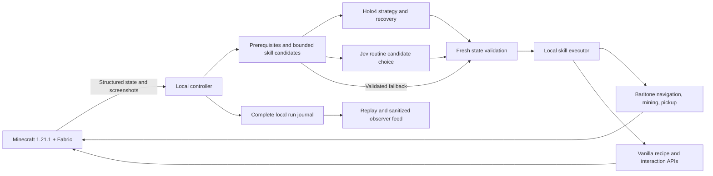

# State-aware hybrid architecture

The default live mode (`GAMEPLAY_MODE=state`) combines structured Minecraft
state with Holo4 strategy, Jev candidate selection, and deterministic local
skills. The environment-backed live default is `RUN_GOAL=nether`: reach the
Nether and verify the actual dimension change. `RUN_GOAL=early_game` retains the
wood, table, wooden pickaxe, stone pickaxe, and stone axe benchmark. Direct
`Settings()` construction defaults to `early_game` for existing fixtures; the
CLI's environment loader defaults to `nether`.

Actual resource collection and a separate stone-tools continuation are recorded
in [state-aware verification](state-aware-verification.md). Fixed-seed development
trial `20261108T100936-acd35b07` started with empty inventory and reached the
Nether goal at 25.304 seconds, with zero recorded errors or recoveries. The
[independent review](run-judge.md) checked all seven linked milestone state assets,
their hashes, and visual evidence. A fresh repeat after the final merge remains
pending; this single trial does not establish random-seed reliability.

## State and planning

The Fabric client provides position, orientation, velocity, health/hunger,
inventory, current screen and slots, crosshair target, nearby blocks/entities,
and bounded local geometry. It labels sampled bounds, truncated results, cache
age, and unknown-world state. This is broader than visual perception, but it is
not an unlimited map of unloaded chunks. Screenshots preserve the spectator
experience and give Holo visual context; the agent's HUD is excluded.

The local prerequisite planner creates valid next candidates from fresh state.
Skill types are `mine`, `craft`, and the capability-gated `portal`. Mining and
crafting use an exact item ID, total inventory target, and tick deadline.
The early-game allowlist covers logs, planks,
sticks, crafting tables, wooden pickaxes, and the materials/tools for the stone
goal. A candidate is a next step, not a long script to execute without checking
the world again. The planner accounts for ingredients already converted into
tools and remembers a verified crafting-table position, so a return from mining
does not automatically trigger another wood/table cycle.

The direct portal route requires `MINECRAFT_SEED=-1950884254474434485`, an
Overworld snapshot, Baritone, and the client's advertised
`portal:minecraft:nether_portal` capability. Its waypoint is `(48,68,48)` in Java
1.21.1. This seed-specific route knowledge does not create current-world facts:
the local executor checks the actual chest, frame, supplies, placement, and
ignition. The route can start without stone tools. A different or undeclared
seed never inherits this waypoint. The [protocol](protocol.md) documents its
bounded composite skill and the [route research](nether-route.md) records sources.

Holo4 chooses strategy on the first step, when the confirmed milestone phase
changes, and after a failed skill. When configured, Jev selects the routine next
candidate even when only one prerequisite remains; without Jev that choice is
local. Both models select an existing ID; neither rewrites the
candidate's parameters. Model failures or
replans are recorded separately from actual physical failures. A deterministic
candidate fallback still has to pass current local preconditions. Remote model
latency does not determine how long movement or mining runs.

The orchestration layer currently caps a strategic selection at eight seconds
or the remaining run budget, whichever is shorter. A selection timeout uses the
recorded local fallback; it does not leave a key held during another cloud retry.

See [provider contracts](providers.md) for the exact native tool and Jev choice
formats. The older `GAMEPLAY_MODE=visual` path remains available for comparison;
its per-action screenshot validation is not the state-aware execution policy.

## Normal-mechanics execution

Baritone's supported public API handles path planning, movement, aiming,
continuous block breaking, and matching dropped-item pickup. Crafting uses the
actual game recipes and normal client interaction/screen-handler APIs, preserving
ingredient consumption and server validation. The portal skill combines bounded
approach, normal chest transfer, frame repair, ignition, and entry. A held log target or a broken
trunk is not proof that a log reached inventory.

One skill owns controls at a time. The raw input executor must not fight
Baritone's key overrides. A skill acknowledgment accepts the request; fresh skill
status and inventory establish mining/crafting outcomes. Portal completion
instead requires a fresh, ready, living player in `minecraft:the_nether`;
an accepted or completed acknowledgment alone cannot establish it.

Pausing, F8, disconnects, lost focus, unexpected world changes, timeouts, and run
budgets cancel active work and release input ownership. During an active portal
skill, the expected dimension transfer releases controls while the controller
allows up to five seconds for fresh destination state. Other world changes
pause the run. Stale model replies cannot restart cancelled work.

State-aware milestones use physical observations: acquired wood/planks, an
available crafting table, a wooden pickaxe, and the required stone tools. A later
tool does not fabricate an earlier unobserved milestone, and dropped stacks do
not count as inventory. Earlier verified milestones may remain recorded after
their ingredients are consumed. The ordered portal milestones are:

| Milestone | Required evidence |
| --- | --- |
| `portal_located` | Client-verified loaded portal geometry. |
| `chest_looted` | Normal chest transfer followed by authoritative inventory synchronization and relevant item gain. |
| `obsidian_acquired` | Actual owned obsidian, or its retained client-verified acquisition step. |
| `ignition_acquired` | Actual flint and steel/fire charge, or its retained client-verified acquisition step. |
| `portal_repaired` | The client checks the required repaired frame block. |
| `portal_lit` | The client checks actual portal blocks. |
| `nether` | Fresh actual Nether dimension with a ready, living player. |

The mod's bounded `verified_steps` list retains the six intermediate proofs
after items are consumed. Phase names, model prose, and later milestones never
manufacture earlier proofs. Each milestone links to its full recorded state.

## Observability and limits

Local journals retain state/observations, requests and responses, decisions,
skill commands, acknowledgments, outcome evidence, screenshots, timing, usage,
failures, and recovery. Credential redaction applies before logging. The hosted
dashboard receives sanitized state and run journals, including ordinary model
request/response text; credentials and inline images are removed. Full original
journals, screenshots, and compressed state assets stay local. Replay inspects
recorded evidence rather than re-executing the Minecraft world.

The hosted camera uses Minecraft-window-only H.264/fMP4 HLS. Its target follows
display refresh, or an explicit `--video-fps 60`; this is separate from measured
browser playback FPS and actual game-render cadence. A one-FPS JPEG fallback,
telemetry, archive publication, and operator commands run independently. HLS is
a rolling live buffer, not a complete video archive.

Public viewing and private operator capabilities are separate. Authenticated
commands have a 30-second delivery window and a durable local dispatch ledger.
New recorded run archives the current recording and starts another in the same
world; resume, pause, and stop/archive operate on that recording. Starting uses
the mod's guarded rearm acknowledgment. See the [dashboard guide](../dashboard/README.md)
for operator access and publishing.

Devin runs outside the gameplay loop. The real v3 integration submits a bounded
diagnostic digest only when requested, caps an investigation at 2 ACU, and returns
analysis plus proposed test source for review. A real investigation and its
validation limits are documented in [the investigation report](devin-investigation.md).

Demo mode uses scripted decisions and generated frames, without Minecraft or
model calls. Historical [verification results](verification.md) identify their
visual-control architecture and evidence. Use the separate
[state-aware results](state-aware-verification.md) for measured live outcomes;
simulation timings and encoder targets are not gameplay performance results.

## Reused components and attribution

- **Baritone 1.11.3:** official Fabric 1.21/1.21.1 API build, LGPL-3.0 metadata
  with v3-or-later source headers. Installed as a separate, checksum-pinned JAR;
  no binary is committed. See the [official release][baritone] and
  [upstream license][license].
- **Minecraft/Fabric/Yarn APIs:** version-specific state and ordinary interaction
  interfaces; recipes come from the running game.
- **AltoClef, Mineflayer, and Voyager:** research references for task decomposition,
  inventory postconditions, pickup, and failure feedback. They are not additional
  installed execution backends in this integration.
- **CraftGround:** observation-schema reference. Its upstream license metadata is
  inconsistent, so its implementation is not copied.

The [research notes](state-aware-research.md) contain exact source links, artifact
digest, API signatures, alternatives, and licensing details. Follow
[setup](setup.md) to install the pinned dependency.

[baritone]: https://github.com/cabaletta/baritone/releases/tag/v1.11.3
[license]: https://github.com/cabaletta/baritone/blob/v1.11.3/LICENSE
