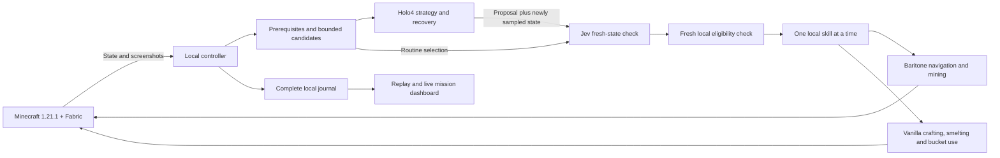

# State-aware hybrid architecture

The live defaults are `GAMEPLAY_MODE=state`, `RUN_GOAL=nether`, and
`NETHER_ROUTE=from_scratch`. Holo4 strategy and Jev fresh-state checks select
bounded local skills that gather, mine, craft, smelt, and build a complete portal
using normal Minecraft interactions. The demonstration uses Java 1.21.1 seed
`-7131204740862824481` and natural lava landmark `(4,63,2)`. Structure loot and
existing portal frames are excluded. [Seed research](new-route-research.md)
verifies the resources, not an autonomous completion time; roughly two minutes
remains a performance target until supported by a live run.

`RUN_GOAL=early_game` retains the separate wood-to-stone-pickaxe-and-axe benchmark.
Direct `Settings()` construction uses that early-game goal for existing fixtures;
the environment loader defaults to Nether. Earlier successful Nether trials used
the [historical ruined-portal route](nether-route.md). Their measured times and
model caveats remain in [verification](state-aware-verification.md) and the
[independent judge report](run-judge.md); they do not validate the new route.

## State and planning

The Fabric client supplies coordinates, orientation, velocity, health/hunger,
inventory, screens/slots, crosshair, nearby blocks/entities, and bounded local
geometry. Sampling labels bounds, truncation, cache age, and unknown cells; it
does not load unseen chunks. Screenshots provide visual context to Holo4 and
exclude the agent HUD. The strategy summary preserves the complete bounded
executor capability list so a model does not mistake an omitted capability for
an unavailable action.

The prerequisite planner selects from `mine`, `craft`, `smelt`, and
`cast_portal`. Inventory tasks carry an exact item, total inventory target, and
deadline. The from-scratch opening normally takes 16 skill completions, but
existing observed supplies can remove redundant steps. It makes a wooden pickaxe
for three cobblestone, upgrades to a stone pickaxe, then mines furnace materials
and four raw iron. A stone axe is not required for this route. Recipes account
for consumed ingredients; world-scoped memory supports returning to a table or
owned furnace without inventing a new workstation.

A bucket and flint and steel consume all four smelted ingots. Actual flint must
be collected from gravel. Spare wood can fuel the furnace; tools are never
burned. Nine dirt/cobblestone mold blocks are reserved only after furnace recipe
consumption, so the same materials are not counted twice. Casting is offered
only with the exact advertised capability, owned supplies, and configured lava
landmark. The landmark is route context, not proof of current terrain or a clear
path. The active mod rejects the old `portal` command; its parser compatibility
in historical Python records does not make structure looting available.

Holo4 selects strategy at the first step, a milestone phase change, or recovery.
Jev checks a newly sampled state after each Holo4 planning attempt when enabled,
including a correctly labeled local proposal after a Holo4 service failure.
Jev also selects routine candidates between strategic calls. Both providers
select an immutable supplied ID; neither rewrites executable parameters. The
controller resamples and recomputes local eligibility before dispatch.

Each model call has a stable request ID and real thinking/complete/failed or
cancelled lifecycle evidence. Strategic calls are bounded to eight seconds or
the remaining run budget. Service fallbacks are labeled local. An explicit Jev
veto prevents execution; an outage after a previous veto cannot silently approve
the same plan. Eight consecutive rejections stop the loop for inspection.
Controls remain released during inference, and late replies cannot restart a
paused run. See [provider contracts](providers.md).

## Normal-mechanics execution

Baritone's public API handles navigation, mining, aiming, and dropped-item pickup.
Crafting uses actual unlocked recipes and ordinary screen-handler interactions.
Flint collection mines gravel and may recycle owned gravel with normal placement
and breaking; gravel inventory is not flint. The furnace helper places an owned
furnace, transfers owned ore/fuel, waits for vanilla cooking, and verifies output
through a fresh server inventory synchronization. It never takes output from an
unrelated structure furnace. Cancellation releases controls while normal furnace
cooking may continue.

The casting executor observes natural water and at least ten exposed still-lava
sources near the landmark. It chooses a clear 5×6 workspace with six blocks of
headroom and water-flow separation from the lava pool. Normal placement, mining,
and bucket use create a nine-block mold and form ten new obsidian frame cells.
Each cast consumes an individually recorded natural lava source and waits for
an actual server block update. The final cast consumes the owned water source;
remaining flow drains before flint and steel ignites the complete 2×3 interior.
The executor walks into the portal and uses the normal Survival transfer delay.
[Protocol details](protocol.md) specify bounds and acknowledgments.

One skill owns inputs at a time. An accepted request is not a successful result.
Inventory tasks require their total inventory postcondition; portal completion
requires a fresh, ready, living player in `minecraft:the_nether`. Pause, F8,
disconnect, focus loss, unexpected world changes, death, deadlines, and run budgets
release control ownership. Expected portal transfer permits up to five seconds
for destination state while inputs remain released. After goal confirmation the
controller requests normal single-player pause so an unattended player is not
left exposed to Nether mobs; pause availability is recorded separately.

## Evidence-backed milestones

The from-scratch dashboard has fourteen checkpoints:

| Milestone ID | Required recorded evidence |
| --- | --- |
| `wood` | Owned logs or planks. |
| `crafting_table` | Owned table or verified available table. |
| `wooden_pickaxe` | Owned wooden pickaxe. |
| `stone_pickaxe` | Owned stone pickaxe. |
| `furnace` | Owned crafted furnace. |
| `iron_mined` | Owned raw iron or iron ore. |
| `iron_smelted` | Owned iron ingot. |
| `bucket` | Owned empty or filled bucket. |
| `flint_and_steel` | Owned flint and steel. |
| `water_collected` | Owned water bucket or retained client-verified collection. |
| `lava_located` | Client-verified natural source pool. |
| `portal_built` | All ten newly cast frame cells verified. |
| `portal_lit` | Actual portal interior blocks verified. |
| `nether` | Fresh actual Nether dimension, ready world, living player. |

Resource milestones show first acquisition; a skill still needs its full target
quantity to complete. Earlier proven steps survive normal item consumption.
Phase names, model prose, later items, and dropped stacks do not manufacture
missing proofs. Each milestone links to its full state asset, tick, and inventory
or client-verified evidence.

## Observability and integrations

Complete local journals retain observations, compressed states, model payloads,
decisions, commands, acknowledgments, outcomes, screenshots, usage, timing,
failures, and recovery, with credential redaction. Hosted journals are sanitized,
bounded copies; full originals stay local. Replay inspects recorded evidence and
does not rerun the Minecraft world.

The live camera uses Minecraft-window-only H.264/fMP4 HLS. Its target follows
display refresh or `--video-fps 60`, separately from measured browser FPS and game
render cadence. A one-FPS JPEG fallback, telemetry, archives, and operator commands
run independently. HLS is a rolling live buffer rather than a full video archive.
The mission panel animates actual fresh Holo4/Jev requests and local execution,
then retains completed decisions without implying continuous inference.

Public viewers cannot control the game. Private operator commands have a
30-second dispatch window and durable claims against accidental replay.
New run saves and unloads the previous world, copies the verified pristine
template into a unique save, and loads it through Minecraft's normal client API.
Only verified empty-inventory, full-health starts arm the agent and begin its timer.
Pause, Stop, F8, or a disconnected bridge cancel pending automatic startup.
Old worlds and logs remain available. Resume requires guarded mod rearming. [Dashboard setup](../dashboard/README.md)
documents access and publishing.

[Devin engineering](devin.md) prepares an exact redacted run brief for operator
review, submits the approved hash with a 2-ACU cap, and publishes bounded findings
and proposed tests. Durable claims prevent duplicate paid submissions. Proposed
code is not applied automatically and gameplay never waits for the investigation.
The [real investigation report](devin-investigation.md) preserves its validation
limits.

[Gladia voice interaction](gladia.md) starts from an explicit microphone gesture.
The browser streams audio through an ephemeral Gladia session; only final
transcripts enter the private operator command path. Partial captions do not
execute controls. Pause/stop/resume use bounded local commands; guidance informs
Holo4 within the available skills, and questions use recorded state. Server
credentials remain private, and raw microphone audio is not stored by HoloSpeed.
API/synthetic-audio verification is distinct from production microphone testing.

Demo mode uses scripted decisions and synthetic frames without Minecraft or model
calls. Historical [visual-mode results](verification.md) and current
[state-aware results](state-aware-verification.md) keep their architecture and
limits explicit.

## Reused components and attribution

- **Baritone 1.11.3:** official Fabric 1.21/1.21.1 API build, LGPL-3.0 metadata
  with v3-or-later source headers. Installed as a separate, checksum-pinned JAR;
  no binary is committed. See the [official release][baritone] and
  [upstream license][license].
- **Minecraft/Fabric/Yarn APIs:** version-specific state and ordinary interaction
  interfaces; recipes come from the running game.
- **AltoClef, Mineflayer, and Voyager:** research references for task decomposition,
  inventory postconditions, pickup, and failure feedback. They are not additional
  installed execution backends in this integration.
- **CraftGround:** observation-schema reference. Its upstream license metadata is
  inconsistent, so its implementation is not copied.

The [research notes](state-aware-research.md) contain exact source links, artifact
digest, API signatures, alternatives, and licensing details. Follow
[setup](setup.md) to install the pinned dependency.

[baritone]: https://github.com/cabaletta/baritone/releases/tag/v1.11.3
[license]: https://github.com/cabaletta/baritone/blob/v1.11.3/LICENSE
