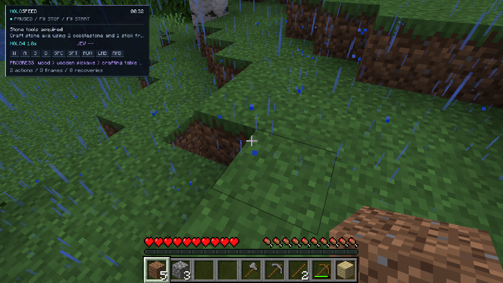
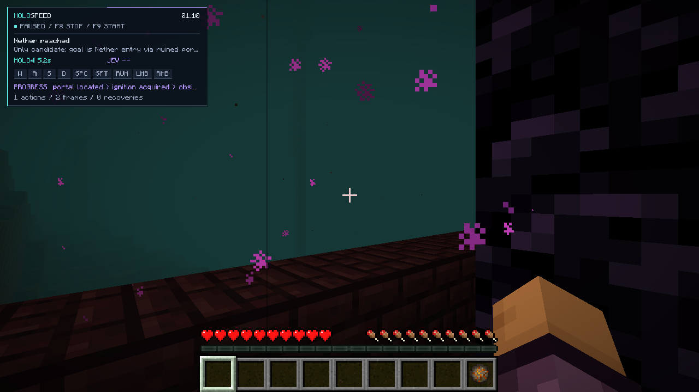

# State-aware gameplay verification

These are actual Minecraft Java 1.21.1 Fabric trials on 2026-11-08, using the
fixed seed `-1950884254474434485`. Full model requests/responses, screenshots,
compressed state snapshots, skill requests, and outcomes remain in local run archives.

## Resource collection and crafting

Run `20261108T093147-8080fe49` completed six inventory-verified skills: three
birch logs, twelve planks, a crafting table, eight sticks, a wooden pickaxe,
and six cobblestone. It took approximately 53 seconds from the successful
resume to the final stop. The recording also includes an earlier startup attempt
and waiting time; its full elapsed timer is not a speedrun result.

Holo4 selected phase objectives; Jev selected routine crafting skills in 239 and
266 ms. One Holo response exhausted its former 256-token budget and fell back
to the validated local prerequisite plan. The strategy budget is now 512 tokens,
with the existing eight-second wall deadline.

The run stopped because mining moved below the placed table and the original
planner no longer considered it available. The fix preserves a world-scoped
observed table position, verifies it against loaded blocks, navigates back,
and reserves stone-tool materials from scaffolding use.

## Verified return and stone tools

Continuation `20261108T094549-4c23f633` started with the previous inventory. It
returned from approximately `(36.5,52,35.6)` to the table, crafted a stone pickaxe
and a stone axe, and confirmed both in inventory at 25.2 seconds. The goal event
and final screenshot were recorded at 25.54 seconds. Both skills completed with
zero failures, full health, and full hunger. Two Holo calls took 3.50 and 1.84 seconds.

This is a continuation across a development restart, not an uninterrupted
spawn-to-stone benchmark. At the operator's request, the saved demo world was
set to daytime before this continuation; a backed-up original save and the
single changed `DayTime` value are recorded under `runs/evaluations/daytime/`.

## Integration failures retained

Run `20261108T092730-bfe4d8a0` timed out before any completed skill because
Baritone's first loot lookup blocked Minecraft's render thread. The replacement
prepares immutable lookup data off-thread and starts mining on the client tick;
cancellation discards late preparation results. The subsequent real mining trial
passed that startup point and collected the requested inventory.

## Hosted observation and controls

The public dashboard serves sanitized journals and a Minecraft-window-only feed.
An authenticated pause command completed end to end on 2026-11-08; unauthenticated
queue access returned 401. Operator capabilities are separate from publisher
credentials. Source-level and HTTP checks cover freshness, bounded commands,
asset integrity, and replay. No browser playback test is claimed in this managed
environment, where the approved browser-testing tool is unavailable.

The H.264 encoder produced actual window-capture segments at 960×540 and 60 FPS.
That is an encoding cadence, not a claim about unique Minecraft rendered frames
or delivered browser FPS. Production video delivery is being measured separately.

## Nether entry from an empty inventory

Run `20261108T100936-acd35b07` began at the spawn of the newly created
**HoloSpeed Fresh** survival world, with an empty inventory. The controller
selected the known ruined-portal route and performed all movement, chest looting,
obsidian placement, ignition, and portal entry autonomously.

| Verified checkpoint | Run elapsed |
| --- | ---: |
| Portal geometry located | 6.26 s |
| Ignition item acquired | 12.01 s |
| Obsidian acquired | 12.51 s |
| Chest loot synchronized with server | 13.22 s |
| Frame repaired | 14.15 s |
| Portal lit | 14.82 s |
| Actual Nether dimension | 24.67 s |
| Goal event and final observation | 25.30 s |

The player arrived with full health/hunger and one remaining fire charge. The
single bounded portal skill completed with zero errors and zero recoveries. The
independent [judge report](run-judge.md) verifies linked snapshot hashes, inventory
consumption, normal portal dwell, and the vanilla Nether advancement.

This is a fixed-seed, state-aware demonstration measured by controller wall time;
it is not an official competitive speedrun result. The run began after world
loading and setup. A post-merge fresh-world repeat is recorded separately by the
judge. The route can bypass wood and stone tools because the chest supplies the
required obsidian and ignition item; those skipped checkpoints remain unearned.

## Current automated verification

The integrated Python suite passed **529 tests**, Ruff lint/format checks passed,
and the Fabric build/remap passed **64 tests**. The dashboard passed **86 tests**
and its Worker bundle built successfully. Production HTTP checks verified public
viewing, protected commands, detailed archives, and current video playlists.
Six downloaded one-second hosted video segments decoded to **360 H.264 frames**
at **960×540, 60 FPS**. Their playlist capture age at publication was approximately
three seconds. Delivered browser FPS is measured by the UI, not inferred from
that encoder measurement.

The hosted mission panel follows real inference request IDs and terminal events,
including cancellation and local fallback. Holo4 proposals now receive a fresh-state
Jev check before another local eligibility check and dispatch. The trial above
predates this handoff; its model evidence is Holo4-only.

The deployed Devin workflow prepared a 19,443-byte private brief through the
operator command queue with an exact SHA-256 match and fixed 2-ACU cap.
Unauthenticated command inspection returned 401. The public historical report
contains two proposed test patches and no prompt. This check created no new
paid investigation; the existing session is suspended for inactivity.
