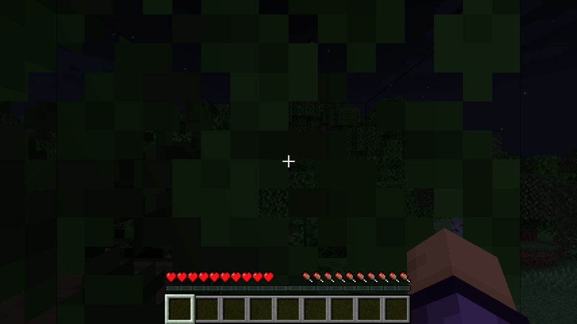
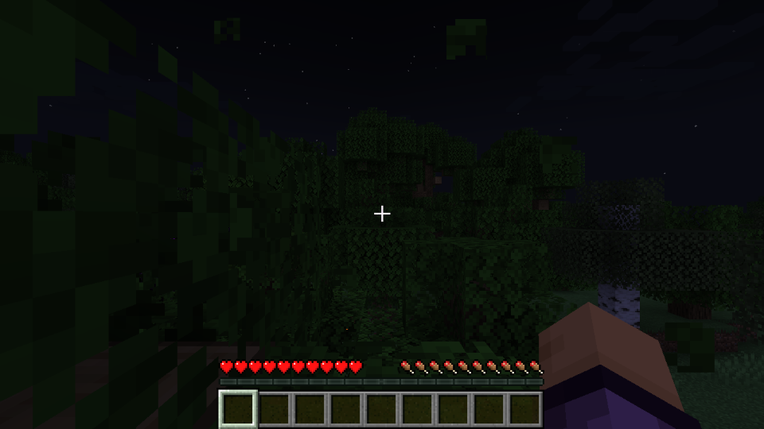
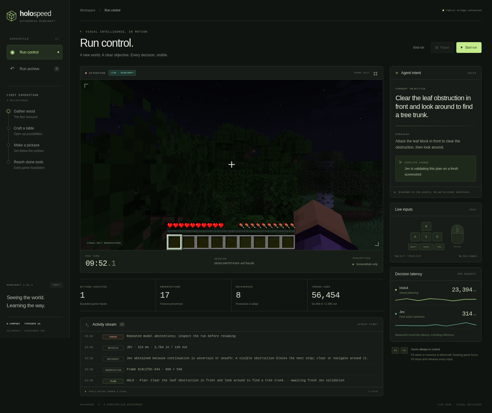
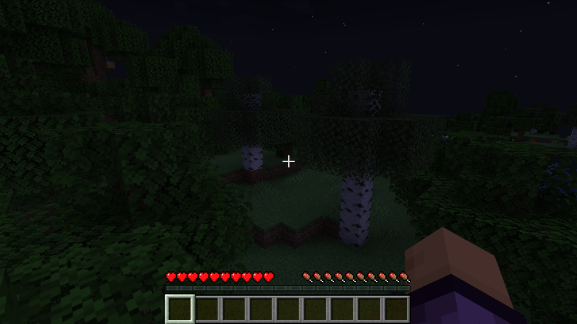

# Verification and observed limits

Tested on 2026-11-08. These results separate simulation, control integration,
and actual model-driven gameplay.

## Automated and interface checks

* 106 Python tests passed at the initial implementation commit; subsequent
  exploration, recovery, and deadline changes expand the suite to 133 tests covering provider formats, fresh-frame validation,
  cancellation, credentials, action bounds, recordings, replay, and API controls.
* The Fabric mod built and remapped successfully; 14 Java tests passed.
* Both GitHub CI jobs passed for implementation commit `01c2f56`.
* Browser checks passed start → pause → finish → replay, two-run comparison,
  accurate acknowledged-action counts, and layouts at 1440px and 390px.
* The Python wheel includes the console assets and was built successfully.
* A real Minecraft development client passed the separate
  [bridge/control smoke test](../fabric-mod/VERIFICATION.md).

## First model-driven trial with executed controls

Run `20261108T074343-ad73a1d6` used Java 1.21.1, Survival/Easy, the
[selected fixed seed](demo-seed.md), Holo4-35B-A3B with thinking disabled,
and Jev 1.14.0. Cheats and the bonus chest were disabled.

Holo proposed a ten-tick attack against a leaf obstruction. Jev validated the
proposal on a new screenshot in 359ms, and the real mod acknowledged execution
from tick 23559 to 23569. The subsequent screenshot shows that the immediate
leaf obstruction cleared. This is real gameplay progress, not the demo fixture.

| Result | Observed value |
| --- | --- |
| Time until bounded recovery stop | 186.5 seconds |
| Completed actions | 1 |
| Observations | 17 |
| Recovery attempts | 8 |
| Confirmed wood/tool milestones | 0 |
| Reported input/output tokens | 54,069 / 2,385 |

Before the acknowledged action:

First observation after the acknowledged action:

The hotbar remains empty and the player retains full health/hunger. Later
proposals were repeatedly rejected as obstructed, and the controller stopped
when its recovery budget was exhausted. This does **not** establish reliable
wood collection, crafting, Nether progression, or a completed speedrun.

The actual run in the spectator console, including its stopped error state:

All live attempts remain in the local ignored `runs/` directory,
including failed model outputs, input requests, acknowledgments, timestamps,
usage, and screenshots. Full request bodies and credentials are not published
in this report. The console can replay and compare these local runs.

The next gameplay work is calibrating bounded exploration and testing short
action sequences against the next screenshot. Hosted Holo latency, Jev's
experimental vision, and repeated rejected plans are current limitations.

## Bounded exploration follow-up

Run `20261108T075559-7e823ced` enabled the user-selected exploration policy.
It completed a short attack after 20.5 seconds and a short forward movement
after 98.4 seconds. The next frame confirmed slight movement. It stopped after
173.5 seconds with 2 completed actions, 18 observations, 8 recoveries, and no
wood milestone. Holo median latency was 17.9 seconds; Jev median was 511ms.
These sequential trials started from different canopy views and are not a
controlled performance benchmark.

The subsequent recovery implementation adds a small camera-only scan after
two identical rejected proposals. The scan is validated by Jev against a fresh
frame, does not move the player or use items, and requires Holo to interpret the
new view. It is bounded to four attempts per run and disabled when exploration
is disabled. This is a local recovery policy, not a model-generated action or
evidence that wood collection now succeeds.

## Real camera recovery check

Run `20261108T080357-7967ff6d` verified the recovery in the actual game:
local proposal event 88 → fresh Jev approval 91 → completed ACK 95 → changed
observation 96 → Holo replanning 99. The scan held no keys, turned 25° right
and 15° down for one tick, and exposed ground and a nearby birch trunk.

The run executed 5 actions and captured 21 observations, then exhausted eight
recovery attempts without obtaining wood. Holo median latency was 23.0 seconds;
Jev median was 338ms. This establishes real visual recovery, not tool collection.

The original loop checked its 180-second budget only between decisions, so this
trial stopped at 193.6 seconds while an inference completed. No action executed
after the deadline. The controller now applies the remaining deadline to
observations, inference, and action execution, cancels in-flight operations when
it expires, and releases inputs. Regression tests cover this behavior and the
preservation of late cancellation acknowledgments in the complete wire journal.
